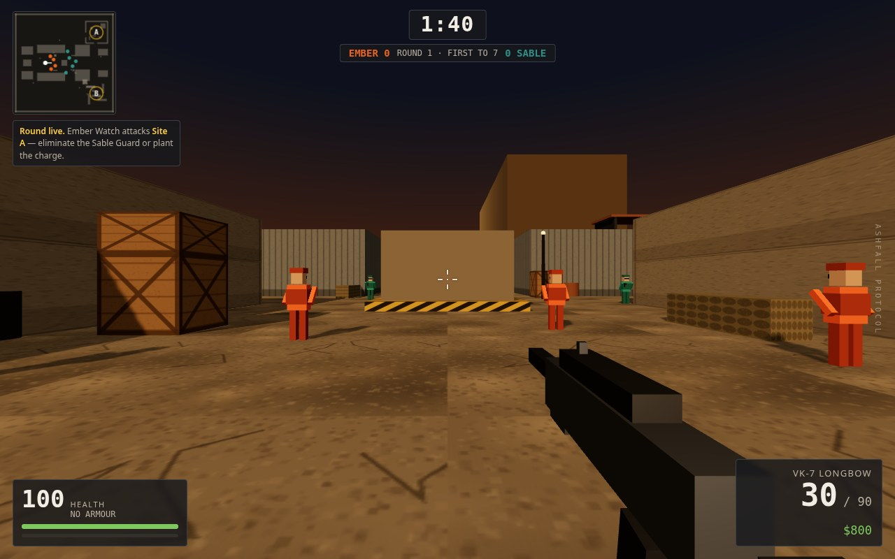

# ASHFALL PROTOCOL

A round-based tactical FPS for the browser, built with [three.js](https://threejs.org) — Counter-Strike-style structure, entirely original map, art, sounds and names. No build step, no network requests: open it and play.

**Ember Watch** (attack) assaults a dust-choked industrial compound held by the **Sable Guard** (defence). Win rounds by eliminating the other team — or plant the **breach charge** at Site A or B and hold until it detonates. The Guard wins by running out the clock or defusing. First to **7 rounds** takes the match.



## Play

```sh
node serve.ts          # serves game/ on http://localhost:8080
# or open game/index.html through any static file server
```

Needs a desktop browser with WebGL 2 (Chrome is easiest) and Node.js 22.18+ for the dev server and the hand-in program. Single-player: you + 4 Ember bots vs 5 Sable bots.

## The game

- **Three-lane compound** — a main street through mid, a north lane into the Site A warehouse, a south lane into the Site B container yard, with rotation connectors and a guard tower.
- **Full round economy** — $800 start, kill and round rewards, loss bonuses that grow on a streak; buy a scattergun, SMG, rifle, precision rifle or armour between rounds.
- **Accuracy-first gunplay** — spread blooms hard while moving or airborne and settles to a pinpoint when you hold still, walk or crouch. Five weapons with distinct damage falloff, headshot multipliers and handling; the Needle one-shots through its right-click scope.
- **Bot operators with jobs** — waypoint navigation, line-of-sight perception, reaction delays and aim error that settles the longer they track you, burst discipline, site holds, rotations on contact, a charge carrier who plants and defenders who converge to defuse.
- **Complete HUD** — health and armour, ammunition, money, round timer, score, killfeed, a live minimap, plant/defuse progress, buy menu and scoreboard.
- **Synthesized audio** — every gunshot, beep and stinger is generated with WebAudio at play time; the game ships zero audio files.

## Controls

| Key | Action |
| --- | --- |
| W A S D / mouse | Move / look |
| Left click / right click | Fire / aim down sights |
| Shift | Walk (quieter, steadier) |
| Ctrl or C | Crouch (steadiest) |
| Space | Jump |
| R | Reload |
| B | Buy menu during the buy phase |
| E (hold) | Plant the charge when you carry it |
| Tab | Scoreboard |

## Layout of this repository

- `main.ts` — the hand-in program (Node 22): copies `game/` and `screenshots/` to the output directory and writes `dossier.json` with the vendored library.
- `vendor/makefun-threejs.ts` — the make.fun three.js dossier library, vendored unchanged.
- `game/` — the playable game as static files: `index.html` (one import map) and ES modules under `game/src/` (`world`, `player`, `weapons`, `bots`, `hud`, `input`, `audio`, `palette`, `main`).
- `game/vendor/three/` — three.js 0.187.0, vendored byte-for-byte.
- `screenshots/` — real renders of the game, posed deterministically by its `?shot=` modes (`shots.json` lists them).
- `serve.ts` — a tiny static server for local play.

## License

MIT — see `LICENSE`.
